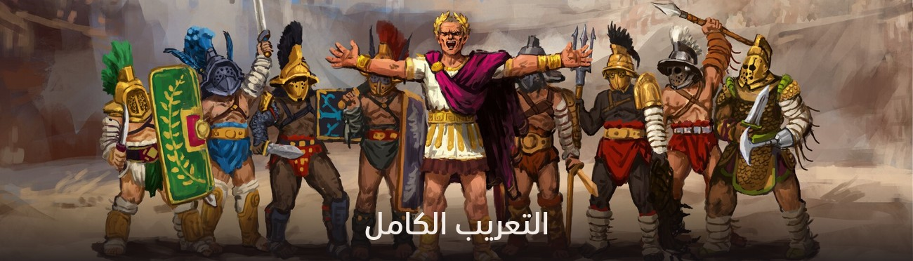

# Dominus Gladiatus - التعريب الكامل

تعريب كامل لـDominus Gladiatus على Steam بالعربية الفصحى: القوائم والإعدادات، والشروحات والأحداث، وفئات المجالدين ومهاراتهم، والعتاد، والقصة، ورسائل الدوميني المنافسين، مع خط SST Arabic. العربية لغة إضافية تظهر في قائمة لغات اللعبة باسم «العربية»، ولا تتغير اللغات الأخرى. الكلام الموجّه إليك يتبع الدومينوس الذي اخترته: صيغة المؤنث مع أوريليا وليڤيا، وصيغة المذكر مع البقية.

## التحميل

من صفحة [الإصدارات](../../releases/latest) حمّل ملف `DominusGladiatus-Arabic-v1.0.0.exe`.

## التثبيت

1. أغلق اللعبة.
2. شغّل المثبّت واضغط «تثبيت اللغة العربية». يجد المثبّت اللعبة تلقائيًا من مكتبة Steam، ويمكنك اختيار مجلدها يدويًا.
3. شغّل اللعبة وستبدأ بالعربية. لتغيير اللغة: الخيارات ثم اللغة، و«العربية» آخر لغة في القائمة.

إن ظهرت رسالة "Windows protected your PC" اضغط More info ثم Run anyway.

للإزالة: شغّل المثبّت واضغط «إزالة اللغة العربية».

## تنبيه

- صُمّم لإصدار Steam، رقم البناء 26566532. بعد أي تحديث للعبة انتظر نسخة جديدة من التعريب.
- لا يُعدَّل أي ملف من ملفات اللعبة. يضيف المثبّت محمّل BepInEx 5، ويُحذف عند الإزالة إن لم تكن هناك تعديلات أخرى تستخدمه.
- أوامر القوائم والشروحات (اختر، اضغط) تبقى بصيغة المذكر مع كل الشخصيات.
- ما بقي بالإنجليزية: شعار اللعبة. ولا يمكن كتابة أسماء المجالدين بحروف عربية.
- أخبرنا بأي نص غير مترجم أو خارج مكانه مع صورة في [Issues](../../issues).

## شكر وتقدير

- Brain Seal Entertainment على اللعبة.
- [BepInEx](https://github.com/BepInEx/BepInEx)، مرخّص برخصة LGPL-2.1.
- خط Rubik في المثبّت مرخّص برخصة SIL Open Font License 1.1.

أعجبك التعريب؟ ادعمني على Ko-fi: https://ko-fi.com/kindiboy

---

Full Arabic localization of Dominus Gladiatus (Steam, build 26566532): 1,679 lines in Modern Standard Arabic covering menus and settings, tutorials and events, gladiator classes and skills, equipment, the story and the rival Domini's letters, with the SST Arabic font. Arabic is added as an extra language in the game's own language menu; the other languages are unchanged, and the game's own files are not modified. Lines addressed to the player follow the gender of the chosen Dominus. Download the installer from [Releases](../../releases/latest).

This is a fan project, not affiliated with or endorsed by Brain Seal Entertainment or PlayWay. Dominus Gladiatus is a trademark of its respective owner.
